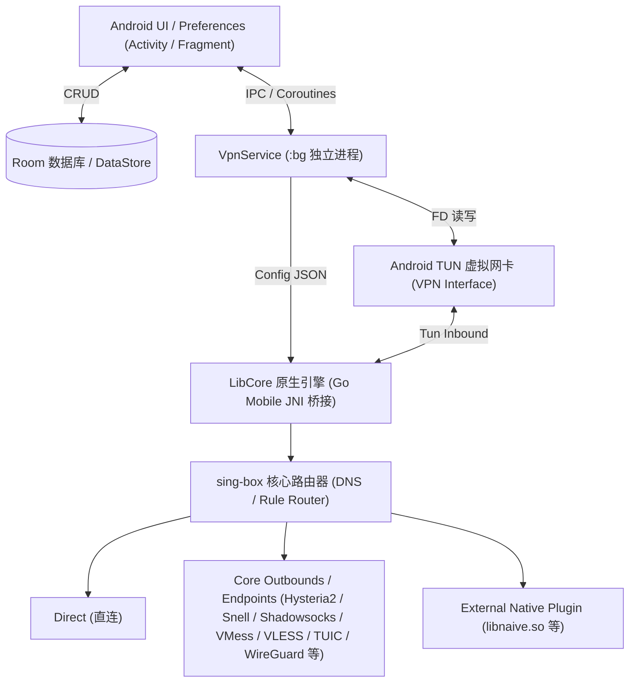

# ThBox 项目技术与评估文档

本目录收录 ThBox for Android 项目的核心技术评估、升级路线、架构拓扑与关键问题排查文档。

## 目录索引

当前版本 **1.6.0**（sing-box 1.14.4）。项目待办以升级清单为准。

### 当前文档

| 文档 | 类型 | 说明 |
|---|---|---|
| [**升级与优化改进清单**](./upgrade-and-improvement-checklist.md) | 路线图 | 唯一的待办来源：1.6.0 已完成的升级、签名、安全与工程化改进，以及“后续计划” |
| [**发布签名与密钥轮换**](./release-signing.md) | 构建与签名 | 包名与覆盖安装原理、v3 密钥轮换、所需 Secrets、发布流程与常见错误 |
| [**常见问题与排查指南 (FAQ)**](./troubleshooting-faq.md) | 用户支持 | 覆盖安装、NekoBox 共存、DNS / FakeDNS、Hysteria2 超时、后台保活、规则文件导入 |
| [**Material 3 适配与 UI 美化评估**](./material-3-ui-adaptation-evaluation.md) | 专题方案（未实施） | 迁移到 Material 3、动态取色、Edge-to-Edge 与预测性返回 |
| [**Shadowrocket 高级规则集可行性分析**](./shadowrocket-advanced-rules-feasibility.md) | 专题方案（未实施） | Shadowrocket 规则在 sing-box / ThBox 中的映射、边界与落地路线 |

### 已归档

内容已实施或已并入升级清单，保留原文供查阅，不再更新。

| 文档 | 说明 |
|---|---|
| [项目问题评估](./archive/project-issues-assessment.md) | 1.5.7 时期的代码、构建与安全问题评估 |
| [代码架构与构建优化评估](./archive/code-architecture-and-build-optimization-assessment.md) | JVM 目标、CI/CD 与依赖治理评估（2026-09） |
| [sing-box 1.14.0 升级评估](./archive/singbox-latest-upgrade-and-optimization-assessment-2026-09.md) | 1.14.0 新特性与破坏性变更评估（2026-09） |
| [安装包签名与证书冲突说明](./archive/android-package-signature-install-conflict.md) | 包名共存与固定 keystore 方案（已被密钥轮换取代） |

---

## 核心架构与数据流拓扑

